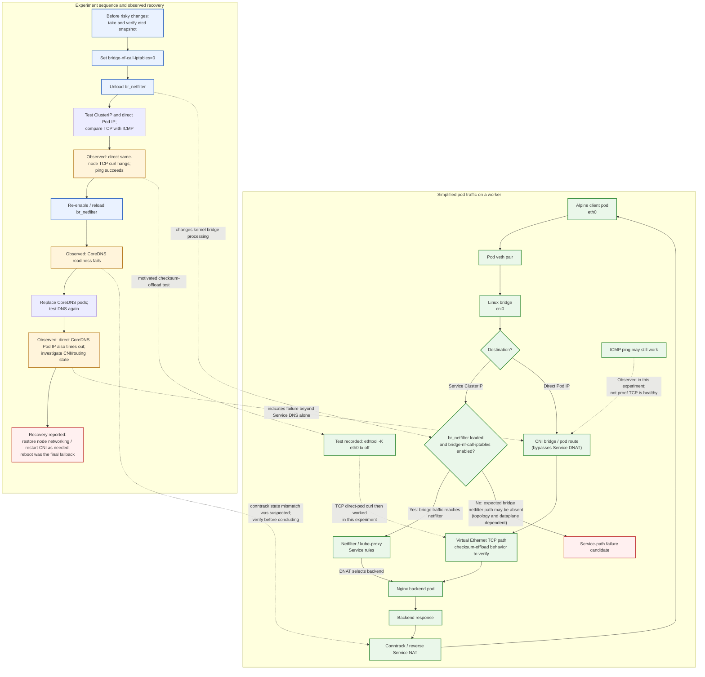

# Kubernetes Networking Deep Dive: The `br_netfilter` Experiment

## Overview
This document logs my hands-on experiment of intentionally breaking my Kubernetes cluster to understand how local networking, bridges, and iptables interact. By disabling the `br_netfilter` kernel module, I expected to break hairpin traffic. What I actually got was a masterclass in Linux networking layers, TCP checksums, connection tracking corruption, and catastrophic CNI failures.

Here is what I did, the hiccups I faced, and how I recovered.

---

## Experiment and packet-path diagram

The diagram combines the simplified packet paths with the sequence and
observations recorded in this experiment. The bridge-netfilter path is a
working model for this lab, not a guarantee that every CNI or kube-proxy mode
handles packets identically. The conntrack/CNI links are investigation
hypotheses from the observed failures, not proof by themselves.



---

## Phase 1: The Setup and The Break
My goal was to understand why Kubernetes requires `br_netfilter`. I learned that the Linux kernel normally isolates **Layer 2 (bridging/MACs)** from **Layer 3 (routing/iptables)**. Because `kube-proxy` relies on L3 `iptables` for Service NAT, local Pod-to-Pod traffic via a Service IP bypasses these rules unless `br_netfilter` forces the L2 bridge to hand packets up to L3.

To test this, I deliberately broke it:
```bash
# Stopped the bridge from calling iptables
sudo sysctl -w net.bridge.bridge-nf-call-iptables=0
# Unloaded the module entirely
sudo modprobe -r br_netfilter
```

---

## Phase 2: The Hiccups and Rabbit Holes

Once the module was off, I started testing connectivity. I ran into several unexpected roadblocks that forced me to dig much deeper into the Linux network stack.

### Hiccup 1: Where is `nf_conntrack`?
I wanted to look at the kernel's connection tracking table to see the asymmetric routing drops, but the `/proc/net/nf_conntrack` file didn't exist on my node.
* **What I learned:** The Linux kernel lazy-loads the `conntrack` engine. It wasn't active in my current namespace or state.
* **How I fixed it:** I forced the kernel to load it via `sudo modprobe nf_conntrack` and installed the `conntrack` CLI tool (`sudo apt install conntrack`) to safely view the tables without locking up the node.

### Hiccup 2: Direct Pod-to-Pod TCP Hung (The Checksum Trap)
I expected Service IPs to fail, but surprisingly, even a direct `curl` from Pod A to Pod B's IP on the same node hung. Oddly, `ping` (ICMP) worked perfectly!
* **What I learned:** This was a **TCP Checksum Offloading** issue. The virtual `veth` interfaces leave TCP checksums blank, expecting hardware to do the math. Without `br_netfilter` pushing the packet through the L3 stack (which auto-calculates software checksums), the packet arrived at Pod B with a blank checksum, and the kernel silently dropped it.
* **How I fixed it:** I proved it by forcing software checksums inside the Alpine pod: `ethtool -K eth0 tx off`. After that, the direct `curl` worked even with `br_netfilter` disabled.

### Hiccup 3: CoreDNS Died After Re-enabling the Module
Satisfied with my tests, I turned `br_netfilter` back on. Immediately, my CoreDNS pods failed their readiness probes and went to `0/1 Running`.
* **What I learned:** Pulling the module out from under active traffic corrupted the kernel's connection tracking (`conntrack`) state. CoreDNS was trying to reach the API server, but the kernel was dropping the packets due to state mismatches.
* **How I fixed it:** I deleted the CoreDNS pods (`kubectl delete pod -n kube-system -l k8s-app=kube-dns`). The new pods initiated a brand-new TCP 3-way handshake, bypassing the corrupted conntrack state. (Alternatively, `sudo conntrack -F` flushes the whole table).

### Hiccup 4: Complete CNI Desync
Even after getting new CoreDNS pods, DNS was still failing. I tried using `nslookup` directly against the new CoreDNS pod IP (bypassing Services entirely), and it timed out. 
* **What I learned:** Toggling kernel modules and flushing `conntrack` completely lobotomized my CNI (Flannel/Calico). The `cni0` bridge state and routing tables were out of sync with the Kubernetes control plane. It wasn't a Service problem anymore; basic L3 routing was dead.
* **How I fixed it:** I realized that tinkering with kernel primitives on a live node causes cascading failures. The surgical fix was restarting the CNI and `kube-proxy` pods on that node. The ultimate fix was a hard `sudo reboot` to let the `kubelet` rebuild the network stack from scratch.

---

## Phase 3: The Ultimate Fallback (etcd Backup)

This experiment taught me how easily a cluster's networking can be permanently destroyed by manual intervention. Before doing anything this destructive in a real environment, I learned I must snapshot the cluster's brain: `etcd`.

**Taking the Backup:**
```bash
sudo ETCDCTL_API=3 etcdctl \
  --endpoints=https://127.0.0.1:2379 \
  --cacert=/etc/kubernetes/pki/etcd/ca.crt \
  --cert=/etc/kubernetes/pki/etcd/server.crt \
  --key=/etc/kubernetes/pki/etcd/server.key \
  snapshot save /opt/cluster-snapshot.db
```

**Restoring from Disaster:**
If the node is beyond repair, I extract the snapshot to a new directory (`/var/lib/etcd-restored`) and update `/etc/kubernetes/manifests/etcd.yaml` to point to it, instantly reverting the cluster to a healthy state.

---
## Conclusion
Breaking `br_netfilter` was supposed to be a simple test of hairpin routing. Instead, it exposed the fragile, intricate dance between virtual Ethernet interfaces, hardware offloading, connection tracking, and overlay networks. 